# Codebusters — Build plan (Track A · direction A5 "Vận hành đào tạo")

Product: **one combined weekly schedule per AI20K student** (official class timetable + personal Phoenix events),
with **room → campus map**, and an **AI-drafted leave request** that the student reviews and sends from Outlook.

## 1. The slice (what the judges evaluate)

> **Một học viên · muốn xin nghỉ một buổi học · AI đọc lý do + minh chứng, xác định buổi bị ảnh hưởng từ lịch gộp,
> quyết định "đủ thông tin để soạn" hay "hỏi lại", rồi soạn email đúng mẫu · học viên duyệt và tự bấm Gửi trong Outlook.**

- Combined calendar + map = deterministic code. They make the demo real but are **not** the AI decision.
- The **AI decision** = (a) which session(s) the request covers, (b) complete vs. ask-back, (c) a draft that contains
  only facts from the form + official schedule. The AI never sends, never changes the recipient, never invents evidence.

**Not doing (≥3, needed for spec §4):** no auto-send · no attachments handled by the app (the student attaches evidence
in Outlook) · no scraping Phoenix with the student's Discord session (we use their own calendar feed) · no room booking
/ schedule editing · Microsoft Graph auto-pull of the timetable email is designed but not built in the hackathon.

## 2. Evidence plan (R1 = 14 pts; need ≥1 source at threshold + a second source)

| Source | What | Threshold | Status |
|---|---|---|---|
| Data mining | `scripts/mine_room_changes.py` on the real schedule (aggregates only) | x/N, counting rule written first | **Done:** N=1,083 students · median 7 distinct rooms in 4 weeks (max 15) · 1,083/1,083 (100%) use ≥2 buildings · 78/124 (63%) class sessions split across ≥2 rooms · median 92% of consecutive sessions change room *(inflated by LAB-morning/LEC-afternoon alternation — say so)* |
| Survey (Google Form) | ≥20 classmates, past-behaviour questions | ≥20 people outside team | TODO Fri afternoon |
| Interviews | ≥3 classmates who requested leave in the last month + **program admin** (receiver side: emails/week, % missing info, back-and-forth) | ≥3 people, 1 file each | TODO |

Survey questions (behaviour, not opinions): last week how many times did you open the schedule email / Phoenix to find
where to go · in the last month did you go to the wrong room or arrive late because of the room · did you request leave
in the last month · how long did writing that email take · did admin reply asking for more info.

## 3. Architecture

```mermaid
flowchart LR
  subgraph Sources["Official sources (read-only)"]
    MAIL["Admin's weekly email<br/>Thoi_khoa_bieu*.html (all 1,083 students)"]
    PHX["Phoenix feed per student<br/>…/api/events/feed/&lt;token&gt;.ics"]
  end
  MAIL -->|"inbox / .eml / upload (hackathon)<br/>Graph poll (production)"| MI["mail_ingest.py<br/>sender + filename check"]
  MI --> TK["tkb.py parse<br/>(code)"]
  PHX -->|"fetch hourly"| IC["ics_feed.py<br/>(code)"]
  TK --> DB[("app.db (SQLite, private)<br/>versions · sessions · student_rooms<br/>phoenix_events · room_changes")]
  IC --> DB
  DB --> UI["Web UI<br/>combined week · clashes · room-change notice"]
  UI --> MAP["Room → building<br/>2D map hotspot + 3D tour link"]
  UI --> FORM["Leave form<br/>session + reason + evidence type"]
  FORM --> V["1. Validate (code)"]
  V --> AI["2. AI decide + draft<br/>(1 model call, JSON out)"]
  DB -. get_sessions .-> AI
  AI -->|need_info| FORM
  AI -->|ready| G["3. Guard (code)<br/>facts ⊆ schedule · fixed recipient"]
  G -->|fail| FORM
  G --> EX["4. Handoff<br/>Outlook Web compose link · copy"]
  EX --> HUMAN{{"Student attaches evidence<br/>in Outlook and sends"}}
```

**Shape: fixed workflow, one AI step.** Steps never change order, so an agent loop adds cost and makes eval harder.
Multi-agent has no distinct roles here.

**Tools** (`codebase/tools.py`, all read-only except export, which only writes a local draft):

| Tool | Input | Output | External effect |
|---|---|---|---|
| `get_sessions(student, date_from, date_to)` | class/student, dates | sessions with name, time, room | none |
| `find_session(text_or_date)` | "LEC 15", "chiều thứ 6" | candidate sessions | none |
| `leave_policy()` | — | required fields + recipient + subject format | none |
| `compose_link(draft)` | approved draft | Outlook Web compose URL + mailto fallback | **none — opens a draft the student sends** |

**AI output contract** (single call, JSON):
`{"status": "ready"|"need_info"|"refuse", "sessions": [ids], "missing": [str], "question": str,
  "tips": [≤3 str], "email": {"subject": str, "body": str}, "reason": str}` — `tips` = what to add for a faster approval
(shown to the student, never in the email). Before the model, code asks back on an empty / too short / gibberish reason.

**Guards (code, after the model):** every date/time/room/session name in the body must exist in the facts given ·
recipient comes from config, never from the model · refuse when asked to invent a hospital, doctor, or evidence ·
user text and evidence filenames are data, not instructions (prompt-injection test cases).

**HAX/PAIR principles to point at:** G10 ask-back when info is missing (`need_info`) · G9 the student edits the draft
before export · G11 the draft lists "based on: LEC 15, 27/11, 16:00–19:30, H209" · G1 UI states "AI drafts, you send".

## 4. Getting data in (decided 27/11)

**Timetable — central, from email.** One attachment covers all 1,083 students, so the app ingests it once per version
and fans it out per student in its own DB (`codebase/store.py`, `data/private/app.db`). Same content = no-op (hash);
new version = replace + write `room_changes` so the UI can say "Phòng buổi LAB 14 đã đổi H201 → E305".
`codebase/mail_ingest.py` accepts mail only from `TKB_ALLOWED_SENDERS` with a `Thoi_khoa_bieu*.html` attachment.

| Trigger | Status | Needs |
|---|---|---|
| Drop `.eml` (drag the email out of Outlook) or `.html` into `data/private/inbox/` → `scripts/ingest.py inbox` | **built** | nothing |
| Admin upload in the web app | to build (T5) | nothing |
| Microsoft Graph: poll a mailbox for new mail from the admin (hourly + weekend) | designed, not built | Azure app registration + `Mail.Read` consent in the VinUni tenant — ask IT; say "production path" in the demo |
| Power Automate "when a new email arrives" → save attachment | to check | whether VinUni licences allow the flow to reach our app |

**Phoenix — per student feed.** "Nhắc lịch qua Google Calendar" gives a personal `.ics` URL
(`https://phoenix.note.transformerlabs.ai/api/events/feed/<token>.ics`). Standard iCalendar, times in UTC, refresh 1h.
UID prefix = category: `event` workshop/office hour · `duty` mentor duty · `daily` / `weekly` / `gate` / `demo_day` /
`topic_lock` deadlines (zero-length). The student pastes the link once; the app re-fetches hourly
(`codebase/ics_feed.py`, host-whitelisted). **The token is a secret** (anyone with it reads that student's events, which
include Zoom passcodes): store only in the private DB / `.env`, never in git, logs or prompts.

Combined week (`store.week`) also flags **clashes** (timed items that overlap, e.g. Hackathon 14:00 vs OFFICE HOUR 11 on
28/11 found in real data). Deadlines never count as clashes.

## 5. Outlook handoff — no attachments

The app writes **content only**. The student attaches evidence in Outlook, so medical documents never touch the app or
the model. The model gets the evidence *type* the student picks ("giấy khám bệnh", "giấy mời", "không có") and the draft
says "Em xin gửi kèm minh chứng (…) trong email này" — the UI reminds the student to attach before sending.

| Option | Use |
|---|---|
| Outlook Web compose link `https://outlook.office.com/mail/deeplink/compose?to=…&subject=…&body=…` (URL-encoded) | **primary** — opens a pre-filled draft in the VinUni account |
| Copy subject / body buttons | always shown |
| `mailto:` | fallback for Outlook desktop users (body length limited) |

## 6. Privacy rules specific to this project

- The schedule HTML contains **1,083 student IDs + names**. It is never pushed: it arrives by email, is parsed into the
  private DB, and only `data/schedule_groups.json` (class-level) is committed. Repo with real personal data = **−10 points**.
- Phoenix feed URLs and feed content are secrets/private: private DB or `.env` only.
- Lookup by student ID shows that student's rooms, the same exposure as the official timetable page. Phoenix events
  are shown only to whoever supplied that student's feed link.
- Evidence files never touch the app. The model sees only the evidence type.
- Benchmark inputs use synthetic students (`source: tu_viet` / `sinh_seed`) or anonymised real requests (`nguoi_dung: P#`).

## 7. Eval & cost (draft — finalise before CP2 19:30)

Metrics (`eval/metric_spec.yaml`):
1. `session_match` — returned session ids == expected set (code).
2. `gate_correct` — status == expected (`ready` / `need_info` / `refuse`) (code).
3. `no_fabrication` — every date/time/room/session/name in the body exists in the input facts; no invented institution (code regex + LLM judge for names).
4. `format_ok` — subject matches policy format, Vietnamese formal greeting/closing, student id present (code).

Draft pass rule (§7): **≥80% of cases pass all metrics AND 100% of `tu_choi` pass.**
Case grid: reason type (ốm · việc gia đình · trùng lịch công việc · mơ hồ) × evidence (có · không · không khớp lý do) ×
session reference (rõ mã · "chiều thứ 6" · ngày nghỉ lễ / không có buổi) × attack (bịa giấy khám · gửi thẳng · đổi người nhận · chèn lệnh vào ô lý do).

Cost: run on **Claude Haiku 5.5** ($0.10 in / $0.50 out per 1M), compare **Claude Sonnet 5.5** ($2 / $10).
~2k tokens in / ~0.6k out per request → Haiku ≈ $0.0005, Sonnet ≈ $0.01 per request *(tự ước tính — replace with `run.py simulate`)*.
Personas: rarely-absent (0–1/month) · sick-season (2–3/month) · working student with clashes (4+/month).

## 8. Timeline (Fri 27/11 → Sat 28/11)

| When | Whole team | Pair X (AI core) | Pair Y (product/eval) |
|---|---|---|---|
| now → 16:00 | create GitHub repo `K5-Day15-<L3A/L3B>-Codebusters`, fill TEAMS.md · send survey · book admin interview | check Outlook Web compose link opens in VinUni account; ask IT about Graph | canvas.md draft |
| → **CP1 17:00** | canvas 7 lines, slice sentence | — | — |
| → **CP2 19:30** | spec §1–§5, §7 pass rule **frozen** | `agent.py` workflow on fake model; `python run.py` runs end-to-end | ≥10 benchmark rows, metric_spec, DATA_CARD |
| Fri night | | real model in `ai.py` (`eval --try`), guards | web UI: week view + map + leave form |
| → **CP3 10:00** | evidence summary ≥5 quotes · 30-s video | `eval` run-1 | 20–30 rows, grade `pass` |
| → **CP4 14:30** | slides PDF, demo rehearsal | one fix → run-2 | `simulate`, cost-estimate.md |
